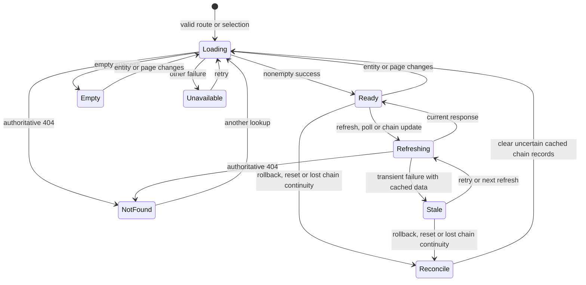
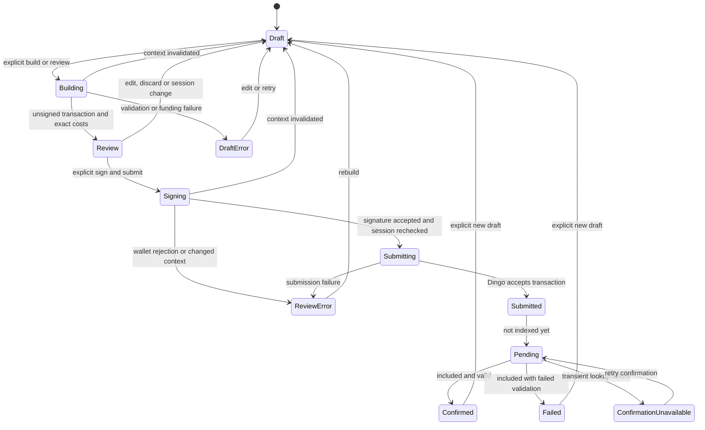
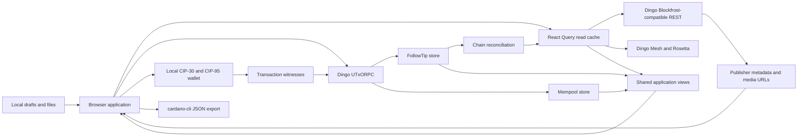

# Dingo application flows

This application demonstrates a complete dApp boundary: Dingo provides chain
state, protocol parameters, evaluation and submission; a local wallet provides
keys and signatures. Browsing, inspecting transactions and editing drafts do not
connect a wallet automatically. The transaction studio can also build unsigned
payments without an extension and export cardano-cli envelopes.

## Navigation and clicks

The main navigation identifies a capability area. Its contextual navigation
identifies the current page; an ancestor section is highlighted without claiming
to be the current page. Discover and Create & build use the same creation-tool
catalog, so a capability keeps its name and description across entry points.

```mermaid
flowchart TD
  Discover[Discover capabilities] --> Explore[Explore the chain]
  Discover --> Create[Create and build]
  Discover --> Participate[Participate]
  Discover --> Markets[Markets]
  Markets --> Swap[Preview SundaeSwap / Preprod Minswap]
  Markets --> Liquidity[Liquidity and order management]
  Markets --> Kernel[Loans, options, orders and financial NFTs]
  Liquidity --> Gravity[Gravity contract-output monitor]
  Kernel --> MarketReview[Build, evaluate and review unsigned transaction]
  Liquidity --> MarketReview
  MarketReview --> Sign[Wallet signs; Dingo submits]
  Sign --> Confirm[Persistent confirmation status]
  Discover --> API[API playground]
  Explore --> Blocks[Blocks and transactions]
  Explore --> Live[Mempool and epochs]
  Explore --> Network[Network and stake pools]
  Lookup[Global lookup] --> Entities[Address, stake account, asset, policy, handle]
  Lookup --> Blocks
  Blocks --> Entities
  Entities --> Blocks
  Blocks --> Studio[Transaction studio]
  Create --> Studio
  Create --> Tokens[Token studio]
  Create --> Proofs[Document proofs]
  Create --> Operations[Batch payments and UTxO workshop]
  Create --> Identity[DRep registration and treasury donations]
  Participate --> Actions[Governance actions]
  Participate --> Surveys[Surveys]
  Participate --> Representatives[Representatives]
  Actions --> Holders[Holder opinions]
  Actions --> DRepVote[Official DRep votes]
  Wallet[Wallet portfolio] --> Send[Send ADA and assets]
  Wallet --> Delegate[Pool and DRep delegation]
  Wallet --> Rewards[Reward withdrawal]
  Representatives --> Delegate
  Network --> Delegate
  Send --> Review[Review, sign and submit]
  Delegate --> Review
  Rewards --> Review
  Swap --> Review
  Tokens --> Review
  Proofs --> Review
  Operations --> Review
  Identity --> Review
  Holders --> Review
  DRepVote --> Review
  Surveys --> Review
  Review --> Blocks
```

The payment entry points have distinct purposes:

- **Send** transfers ADA and an optional native-asset bundle to one recipient.
- **Batch payments** accepts multiple recipients and CSV input, including
  per-row native assets.
- **Transaction studio** builds unsigned ADA payments from an explicit funding
  address, imports CBOR, adds partial witnesses and exports complete transactions.
  It does not submit them.

## Read state machine

A transient refresh error retains a previously loaded record with a visible
status. Initial failure and successful empty results remain distinct. A 404 does
not preserve a claim that an entity still exists. Query-backed disclosures mount
their records only while open. Pagination and disclosures reset with their
entity identity, and page size belongs to the query identity.

Dingo's FollowTip stream supplies apply, undo and reset events. Unknown chain
continuity clears the uncertain live tip and mutable cached records, then
refetches only active records;
no parent hash or block height is invented. Ordinary applies refresh active
chain summaries. Immutable CBOR, static genesis records, catalogs and expensive
on-demand history are not indiscriminately fetched again on every block. Chain
uncertainty also clears verified census snapshots; manually requested recounts
remain manual, while an open survey rechecks its results.

## Transaction state machine

Authored addresses, amounts and choices belong to a draft. A prepared transaction
belongs to a particular wallet connection and immutable draft revision. Editing
fields, changing accounts or replacing a connection invalidates its review and
any outstanding continuation. Leaving a transaction page also invalidates its
outstanding build or signing work at the router transition, before the old view
unmounts. Hash-only links within the page preserve the draft. Returning to an
earlier input value does not resurrect an old approval.

Once submitted, the transaction hash and confirmation state survive draft edits
and wallet UTxO refreshes. An explicit new draft ends that tracking view.
Confirmation lookup failures offer a retry; an included invalid transaction
remains a terminal failure.

Signing helpers check both the current connection and the wallet network before
requesting a signature and again before submission. Dingo's genesis verifies the selected network; CIP-30's network ID distinguishes mainnet from testnets, not Preview
from Preprod. Actual spending and collateral inputs must resolve as unspent
on the selected Dingo chain before review, before signing and after approval.
Only the transaction inputs are checked; the application does not scan the full
wallet. Feature-specific checks additionally cover stake credentials,
eligibility, validity intervals, fees and preservation of the reviewed body.
Mutations are never automatically retried.

A submitted swap is an order, not a completed trade. The view identifies the
SundaeSwap version and contract. V3 orders are pool-specific; V4 intents contain
minimum output and fee constraints and allow a scooper to select the route.
The transaction studio follows the build/import, inspect, optional witness,
export path and never enters submission states.

## Network and data ownership

| Surface                    | Application responsibilities                                                                                                                                    |
| -------------------------- | --------------------------------------------------------------------------------------------------------------------------------------------------------------- |
| Blockfrost-compatible REST | Entity lookup, blocks and transactions, stake accounts, pools, DReps, governance, metadata, surveys, native assets, protocol parameters and network information |
| UTxORPC                    | Genesis verification, bounded UTxO snapshots, protocol parameters, transaction building/evaluation/submission, block CBOR, FollowTip and mempool streams        |
| Mesh / Rosetta             | Historical account-balance snapshots and explicit read-only API playground calls                                                                                |
| Local wallet               | Explicit connection, public account information, spendable balances and signatures; keys stay in the extension                                                  |
| Browser                    | Drafts, CBOR inspection, metadata editing, file hashing, visualizations and JSON exports                                                                        |
| Publisher media            | Optional pool/token artwork and metadata links; these do not replace Dingo as the chain-data source                                                             |

Switching networks disconnects the wallet and stops the old streams before
optionally persisting the new selection and reloading with explicit URL context. Query caches, pending operations and
singleton API clients do not survive that boundary. The current capability is
preserved along with safe ticker filters and page anchors; entity-specific routes
return to a contextual list and old-network entity prefills are discarded.

The API playground accepts relative REST GET paths and a fixed allowlist of
read-only Mesh POST endpoints. Editing the target, path or body cancels an
outstanding request and prevents its response appearing under another request.
A response remains associated with the request that produced it.

## Route families

| Area             | Routes and contextual actions                                                                                                                                                                                                         |
| ---------------- | ------------------------------------------------------------------------------------------------------------------------------------------------------------------------------------------------------------------------------------- |
| Discover         | `/`; capability filters, current chain snapshot and a block mosaic                                                                                                                                                                    |
| Explore          | `/explorer`, `/explorer/mempool`, `/explorer/epoch[/:epoch]`, `/explorer/network`, `/explorer/pools`; drill into blocks, transactions, pools and linked entities                                                                      |
| Entity lookup    | `/explorer/lookup/:hash`, `/explorer/address/:address`, `/explorer/account/:stakeAddress`, `/explorer/asset/:assetId`, `/explorer/policy/:policyId`, `/explorer/handle/:handle`, `/explorer/metadata/:label`                          |
| Participation    | `/participate`, `/explorer/governance`, `/explorer/proposal/:id`, `/explorer/dreps`, `/explorer/drep/:id`, `/explorer/surveys`, `/explorer/surveys/new`, `/explorer/surveys/:hash/:index`                                             |
| Wallet           | `/wallet`, `/wallet/send`, `/wallet/delegate`; portfolio, rewards, transfers and delegation                                                                                                                                           |
| Markets          | `/wallet/swap`; Preview SundaeSwap V3/V4 and Preprod Minswap previews and order review. `/wallet/markets` defaults to lending; `/wallet/markets/:tab` covers `liquidity`, `lending`, `options`, `orders` and `marketplace` on Preprod |
| Creation         | `/wallet/tools` and `/wallet/tools/:tool`; transaction, token, proof, batch, UTxO, DRep and treasury capabilities                                                                                                                     |
| Developer access | `/api`; inspect existing Dingo REST and Mesh responses                                                                                                                                                                                |

## Preprod contract data

Market discovery queries existing Dingo endpoints in bounded pages. Kernel
beacons authenticate protocol outputs; reference scripts are checked against
pinned deployment hashes before construction. Minswap pool and order datums
retain exact integer amounts and output minima. Gravity oracles connect pool
identities to token-holding contracts; the monitor labels these holdings without
claiming a swap quote. No protocol-specific external indexer is used.

A draft belongs to its form inputs, network and wallet session. Any change clears
the reviewed draft and guards outstanding asynchronous signing work. An accepted
transaction hash survives form edits and position selection while confirmation
is pending. Chain rollbacks invalidate affected market snapshots and reset opaque
Kernel cursors before further discovery.

## Transaction evidence and data inspection

Transaction pages and `/explorer/track/:hash` show a shared tracker. Successful
Dingo submissions record a bounded in-memory receipt after the returned ID is
verified. Mempool snapshots supply current observation; indexed transaction
records supply inclusion and script validity. Each poll re-reads inclusion and
the tip. Rollbacks and reconnects reset tracker queries, and unavailable reads
remove the displayed confirmation count. Switching networks returns a tracked
transaction to the empty tracker while preserving the capability.

The data workbench at `/wallet/tools/data` decodes pasted CBOR locally. Loading a
transaction verifies its serialized ID before extracting data. Input resolution
is a separate query, so its failure does not discard witness or output data.
Data selections retain their original CBOR and identify source outputs and
reference scripts. Structured JSON preserves integer precision and makes no
contract-schema assumptions. Transaction and studio datum links prefill the
workbench without a wallet prompt.

Developer sections expose read-only requests using the selected network's API
root, with copy controls and links to the source that builds each experience.
